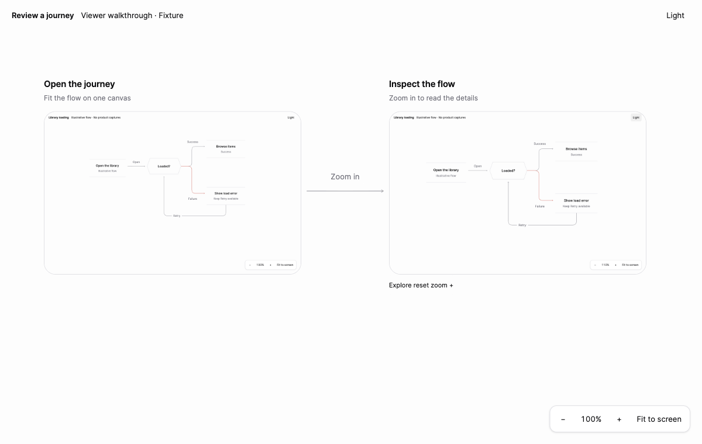

# UI Journey Review

**Ask your coding agent to show what it built as a user flow.**

Screenshots, actions, decisions, errors, and retries—connected on one canvas. A familiar design-review format for reviewing AI-built interfaces.

This repository contains an English agent skill and a portable static viewer. The skill guides the agent through tracing the actual flow, collecting evidence, and presenting the result for human review.



## Install

With the Skills CLI (Node.js 22.20+):

```sh
npx skills add BIAsia/ui-journey-review --skill ui-journey-review
```

Or clone this repository and copy `skills/ui-journey-review` into your agent's skill directory. Keep its `scripts`, `references`, `assets`, and `agents` folders together. The workflow requires file/shell access and a browser or simulator capture tool; it does not depend on a particular browser automation provider.

## Use

```text
Use $ui-journey-review to show the feature you just built as a user flow.
Include the entry point, real screenshots, branches, errors, and retries.
Keep the review read-only and identify anything you could not verify.
```

Other useful requests:

- “Map onboarding for new and returning users. Show where the paths differ.”
- “Show the before and after for this change, including failure and recovery.”
- “Make this feature easier to review: what does the user see, do, and reach next?”

The result is a local static site plus one evidence index with capture provenance and verification limits. Publishing that output is a separate action.

## Try the viewer

Requires **Python 3.10+** and a modern browser. No package installation, application backend, or API key is needed for the examples.

From the repository root:

```sh
python3 skills/ui-journey-review/scripts/build.py \
  skills/ui-journey-review/assets/examples/viewer-walkthrough/journey.json \
  --output dist/viewer-walkthrough
python3 -m http.server 43192 --bind localhost --directory dist/viewer-walkthrough
```

Open [localhost:43192](http://localhost:43192). Choose a different free port if necessary.

The walkthrough uses real browser captures of the viewer itself. It demonstrates screenshot enlargement, theme pairs, and an optional branch without including private product data. A second example, `assets/examples/flow-outline/journey.json`, is an explicitly illustrative diagram with no product screenshots.

## What's included

- A focused [SKILL.md](skills/ui-journey-review/SKILL.md) for evidence-based user-flow reviews.
- A pan-and-zoom canvas with fit/reset controls, light/dark mode, screenshot dialogs, deep links, and optional branches.
- A standard-library Python exporter that validates graph references, local asset paths, theme pairs, checksums, and required provenance.
- [Capture guidance](skills/ui-journey-review/references/capture-and-review.md) and a [data-format guide](skills/ui-journey-review/references/journey-format.md).

The renderer is adapted from an existing product-review workflow. Product-specific paths, accounts, screenshots, and release procedures are excluded.

## What counts as evidence

Use real product captures or clearly labeled fixtures rendering real components. A diagram, mocked screenshot, valid JSON file, or passing export does not prove a product flow works. Still images do not prove timing or motion. The agent must open and inspect the result and identify missing coverage.

The bundled format currently requires light/dark pairs for screen nodes. For a single-theme product or missing captures, record the gap instead of manufacturing a second theme. A schematic flow is useful for planning but is not screenshot verification.

Only build trusted local journey files into a dedicated directory. Before sharing an export, inspect its complete contents and all image pixels for private data. Old output files are not automatically removed; use a fresh export directory for publication.

## License

[MIT](LICENSE).
